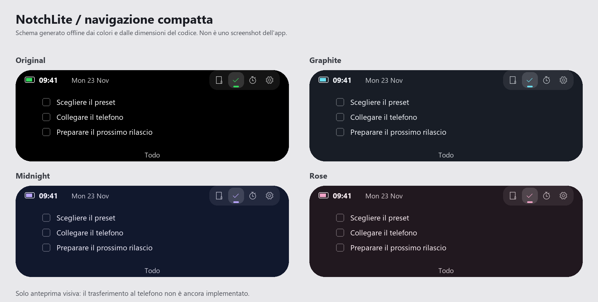

# Navigazione compatta — 0.1.5

Riferimento visivo: [reel Noci Share](https://www.instagram.com/p/DgEXHeggzMe/), fotogrammi campionati a circa 6,38, 12,79, 21,32, 26,87 e 27,58 secondi di 30,02; audio muto, non trascritto. Il frame del trasferimento mostra una barra di icone, schede scure arrotondate e un accento rosato. Non è stato provato il prodotto originale.

## Cambiamento nativo

La notch mantiene dimensioni e corpo della pagina, con una barra compatta delle pagine realmente abilitate. La selezione ha fondo e accento; il nome della sezione corrente, o di quella sotto il mouse, resta leggibile sotto il contenuto. Ora e batteria occupano il lato sinistro; la data viene mostrata soltanto se c'è spazio.

Un clic su un'icona cambia pagina. **Ctrl+Tab** va alla successiva e **Ctrl+Shift+Tab** alla precedente quando il pannello è espanso e nessun editor è attivo. Nessun hook o comando globale intercetta i tasti delle altre applicazioni.

Disegno e hit test usano la stessa geometria. Le vecchie frecce e i puntini vengono sostituiti solo quando la barra entra; altrimenti rimane la navigazione precedente. Non restano bersagli invisibili delle frecce/puntini sotto il contenuto. Il layout supporta fino a 12 pagine e mantiene i pulsanti da 24 DIP.

**Rose** aggiunge sfondo `#21181F`, testo `#FFF2F7` e accento `#F3A4C8`, conservando Original, Graphite e Midnight e le scelte già salvate. Non cambia automaticamente il tema degli utenti esistenti.

L'immagine è uno schema generato offline da dimensioni e colori, con contenuto illustrativo. Non è un render di DirectWrite o una prova della GUI Windows. Font, antialiasing e posizionamento effettivo devono ancora essere osservati.

## Funzioni e prove

Questo incremento non aggiunge dipendenze, worker, listener o nuove superfici grafiche. Il modulo di geometria non alloca collezioni nel frame. La shell continua a formattare titoli/data e a utilizzare renderer e cache esistenti: non si dichiara che l'intera UI sia priva di allocazioni.

I test controllano capacità, limiti, hit test, spazi tra pulsanti, combinazioni di tasti, fallback e contrasto delle quattro palette. La prova GUI, DPI reali, mouse/tastiera e nuova misura RAM restano escluse per il vincolo dell'utente.

Il [collegamento al telefono](PHONE-SHARE.md) è una specifica separata. Non vengono mostrati un QR fittizio o un telefono connesso senza un provider funzionante.
